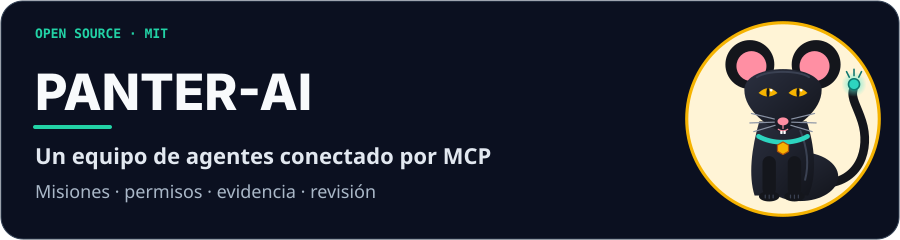
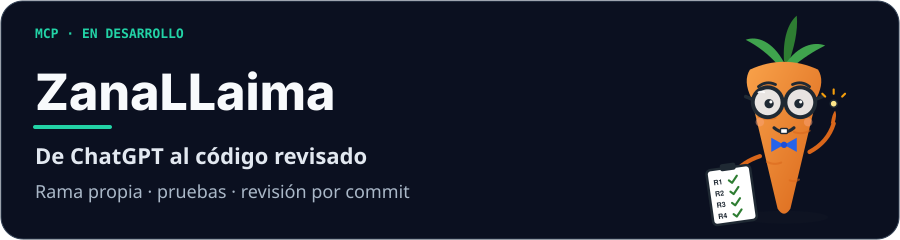
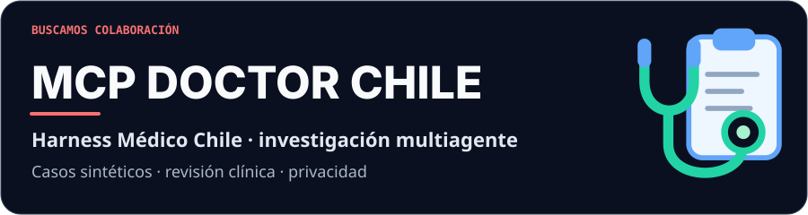
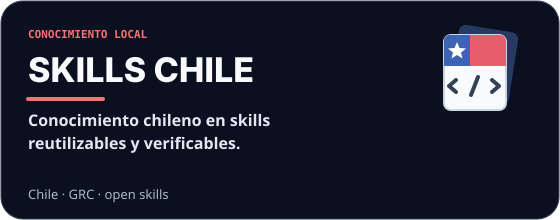
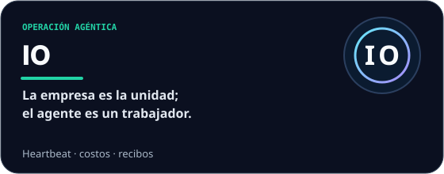
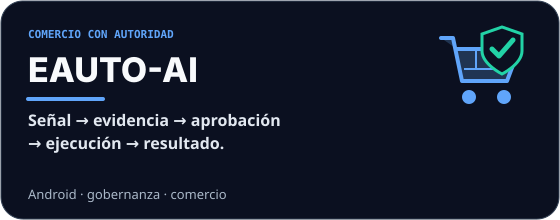
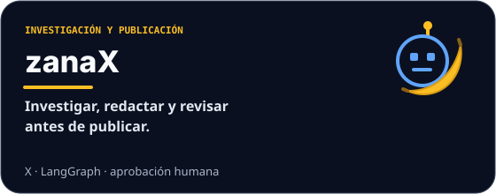
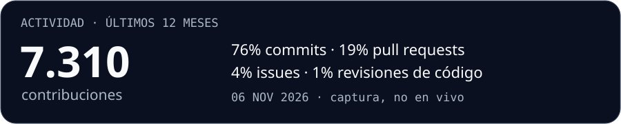

  

  <picture>
    <source media="(prefers-color-scheme: dark)" srcset="https://raw.githubusercontent.com/riquelmechile/riquelmechile/main/assets/profile/hero-dark.svg">
    <source media="(prefers-color-scheme: light)" srcset="https://raw.githubusercontent.com/riquelmechile/riquelmechile/main/assets/profile/hero-light.svg">
    
  </picture>

  
  

## Primero operé el problema. Después construí el sistema.

Vengo del **e-commerce real**: costos, inventario, publicidad, proveedores, reclamos y decisiones con consecuencias. Hoy construyo sistemas agénticos, herramientas operacionales y proyectos de investigación que buscan resolver esos problemas con **autorización explícita, evidencia y resultados comprobables**.

> **Razonamiento probabilístico dentro de límites deterministas.** Una propuesta no es una ejecución; una respuesta convincente no equivale a un resultado verificado.

**Actualizado: 06-NOV-2026.**

**Ahora:** coordinar agentes entre aplicaciones con **Panter-ai**, llevar el desarrollo desde ChatGPT a GitHub con **ZanaLLaima** y construir herramientas con contexto chileno.

[Proyectos](#proyectos-que-mejor-explican-mi-trabajo) · [Cómo trabajo](#la-variedad-no-es-dispersión-es-búsqueda-de-estructura) · [Contacto](https://www.linkedin.com/in/sebastian-riquelme-vera-482778198)

---

## Proyectos que mejor explican mi trabajo

Una selección de sistemas abiertos, investigación y problemas que conozco desde la operación.

### Panter-ai · Control plane abierto

  

**[Panter-ai](https://github.com/riquelmechile/Panter-ai)** · Servidor MCP abierto, con licencia MIT, para coordinar varias aplicaciones de IA como un equipo: un líder reparte el trabajo y los agentes entregan resultados con evidencia. Conserva misiones, permisos y revisiones; conecta el trabajo con ramas, PR y CI en GitHub. **Cada aplicación ejecuta su modelo: Panter no hace inferencia.** Las rutas de activación dependen de lo que soporte cada host.

### ZanaLLaima · De ChatGPT al código revisado

  

**[ZanaLLaima](https://github.com/riquelmechile/ZanaLLaima)** · Harness de desarrollo para la app de ChatGPT mediante un MCP remoto: trabajo en la rama de una misión, pruebas en GitHub Actions y revisión desde una conversación separada sobre el **commit exacto**. El servidor organiza y aplica reglas sin llamar a modelos. **En desarrollo:** el README del proyecto mantiene el despliegue y la prueba completa con ChatGPT como pendientes de observar.

### MCP Doctor Chile · Investigación y colaboración

  

**MCP Doctor Chile** es el nombre de presentación de **Harness Médico Chile**, una investigación privada y experimental sobre evaluación de razonamiento clínico entre modelos de IA, evidencia y contexto sanitario chileno. Hoy es **solo investigación con casos sintéticos**, no un producto clínico, servicio diagnóstico ni sistema validado para pacientes.

**Buscamos colaboración:** médicos, investigadores clínicos, interoperabilidad FHIR/HL7, evaluación de IA, seguridad y privacidad. La hipótesis por estudiar es si la comparación independiente y la crítica cruzada entre modelos aportan valor frente a un modelo individual; **no se afirma una mejora médica demostrada**.

**[Cómo colaborar, límites de seguridad y contacto →](https://github.com/riquelmechile/riquelmechile/blob/main/RESEARCH_COLLABORATION.md)**

### Otros sistemas públicos

  
  

  
  

**[Skills Chile](https://github.com/riquelmechile/Skills-Chile)** convierte procesos y conocimiento contextual en skills con referencias. **[IO](https://github.com/riquelmechile/io)** explora operación agéntica con costo controlado. **[EAUTO-AI](https://github.com/riquelmechile/EAUTO-AI)** aplica límites de autoridad al comercio. **[zanaX](https://github.com/riquelmechile/zanaX)** estudia automatización de investigación y publicación.

### Más exploraciones públicas

- **[Oráculo Chanchín](https://github.com/riquelmechile/oraculo-chanchin)** · Skill en español para explorar I Ching, BaZi y fuentes tradicionales chinas, con una separación explícita entre interpretación cultural y evidencia científica.
- **[MercadoLibre ME1 Chile](https://github.com/riquelmechile/mercadolibre-me1-chile-integrator)** · MVP de logística multitransportista para cotización y seguimiento. La operación Dynamic Freight en producción está sujeta a certificación; otros transportistas dependen de contratos.

<strong>Sistemas privados · Problemas que también investigo</strong>

Descripciones públicas de alto nivel, sin exponer repositorios ni datos internos:

- **[Xanxittoo](https://github.com/riquelmechile/riquelmechile/blob/main/PROJECTS.md#xanxittoo):** contexto durable, autoridad y verificación para desarrollo asistido por IA.
- **[IntelAgent](https://github.com/riquelmechile/riquelmechile/blob/main/PROJECTS.md#intelagent):** investigación cuantitativa con trazabilidad entre datos, señales y evaluación.
- **[Elcontador](https://github.com/riquelmechile/riquelmechile/blob/main/PROJECTS.md#elcontador):** automatización y revisión humana en procesos contables chilenos.

[Problemas, decisiones y límites →](https://github.com/riquelmechile/riquelmechile/blob/main/PROJECTS.md)

---

## La variedad no es dispersión. Es búsqueda de estructura.

Soy **neurodivergente**. Mi manera de trabajar conecta problemas de comercio, finanzas, infraestructura, regulación, contenido e investigación. El interés común es cómo hacer que una decisión sea **autorizada, trazable, verificable y económicamente razonable**.

  <picture>
    <source media="(prefers-color-scheme: dark)" srcset="https://raw.githubusercontent.com/riquelmechile/riquelmechile/main/assets/profile/pattern-lattice-dark.svg">
    <source media="(prefers-color-scheme: light)" srcset="https://raw.githubusercontent.com/riquelmechile/riquelmechile/main/assets/profile/pattern-lattice-light.svg">
    
  </picture>

| Patrón que se repite | Aplicación |
| --- | --- |
| **Autoridad antes de actuar** | Operaciones económicas, herramientas MCP y permisos de agentes |
| **Evidencia antes de confianza** | Control de resultados, revisión de código e investigación |
| **Costo como parte de arquitectura** | Automatizaciones que no necesitan llamar al modelo sin una señal relevante |
| **Contexto local real** | Tributación, salud, comercio y regulaciones chilenas |
| **Aprender del desacuerdo** | Evaluación multiagente y revisión independiente, sin asumir que consenso equivale a verdad |

<strong>Cómo construyo · Especificar, probar y revisar</strong>

Para cambios técnicos trabajo con especificaciones, pruebas, revisión y resultados vinculados al candidato exacto. No confundo un test exitoso con validación de seguridad externa ni una simulación con una integración real.

**SDD → TDD → revisión independiente → evidencia de resultado.**

### Actividad · Un vistazo al recorrido

  <picture>
    <source media="(prefers-color-scheme: dark)" srcset="https://raw.githubusercontent.com/riquelmechile/riquelmechile/main/assets/profile/activity-2026-11-dark.svg">
    <source media="(prefers-color-scheme: light)" srcset="https://raw.githubusercontent.com/riquelmechile/riquelmechile/main/assets/profile/activity-2026-11-light.svg">
    
  </picture>

Archivo histórico: <strong>7.310 contribuciones</strong> en los últimos doce meses; <strong>76% commits</strong>, <strong>19% pull requests</strong>, <strong>4% issues</strong> y <strong>1% revisiones de código</strong>. Fuente: captura del perfil aportada el 06-NOV-2026. Es un registro fechado, no un contador en vivo ni una medida de calidad. La gráfica nativa de GitHub, debajo del README, muestra la actividad actual.

---

  <strong>Build verifiable systems. Connect patterns. Measure outcomes.</strong> 
  Desde Chile · Operar primero · Automatizar con límites · Verificar siempre

  <a href="https://github.com/riquelmechile/riquelmechile/blob/main/RESEARCH_COLLABORATION.md">Colaboración médica</a> ·
  <a href="https://github.com/riquelmechile/riquelmechile/blob/main/PROJECTS.md">Sistemas privados seleccionados</a> ·
  <a href="https://github.com/riquelmechile?tab=repositories">Repositorios</a> ·
  <a href="https://www.linkedin.com/in/sebastian-riquelme-vera-482778198">LinkedIn</a>

