

  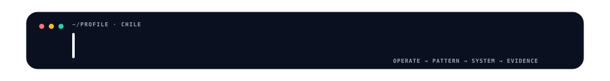

## Actividad GitHub · últimos 12 meses

  <picture>
    <source media="(prefers-color-scheme: dark)" srcset="https://raw.githubusercontent.com/riquelmechile/riquelmechile/main/assets/profile/contributions-year-dark.svg">
    <source media="(prefers-color-scheme: light)" srcset="https://raw.githubusercontent.com/riquelmechile/riquelmechile/main/assets/profile/contributions-year-light.svg">
    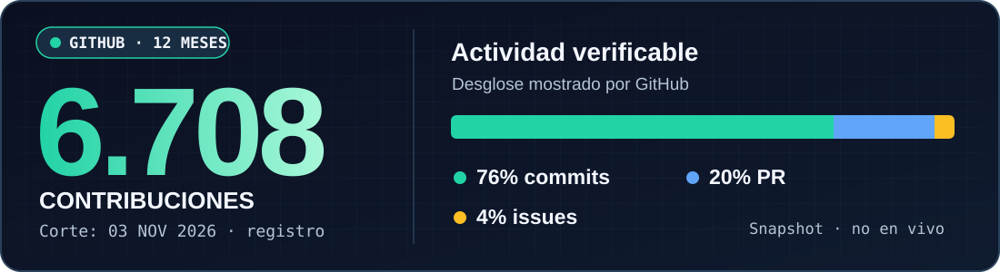
  </picture>

**6.708 contribuciones en el último año** · GitHub Activity Overview: **76% commits**, **20% pull requests**, **4% issues**.

Fuente: captura de la sección Contributions de <a href="https://github.com/riquelmechile">GitHub</a>, 03-NOV-2026. Es una cifra histórica comprobada en esa fecha, no un contador en vivo. La gráfica de contribuciones que GitHub muestra más abajo en el perfil es la referencia actualizable.

  <picture>
    <source media="(prefers-color-scheme: dark)" srcset="https://raw.githubusercontent.com/riquelmechile/riquelmechile/main/assets/profile/hero-dark.svg">
    <source media="(prefers-color-scheme: light)" srcset="https://raw.githubusercontent.com/riquelmechile/riquelmechile/main/assets/profile/hero-light.svg">
    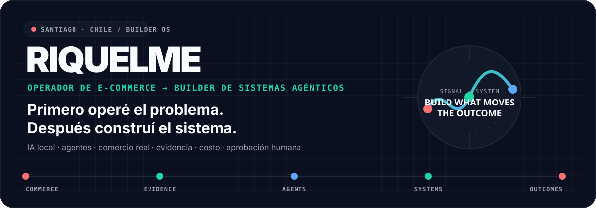
  </picture>

  
  

## Primero operé el problema. Después construí el sistema.

Vengo del **e-commerce real**: costos, inventario, publicidad, proveedores, reclamos y decisiones con consecuencias. Hoy construyo sistemas agénticos, herramientas operacionales y proyectos de investigación que buscan resolver esos problemas con **autorización explícita, evidencia y resultados comprobables**.

> **Razonamiento probabilístico dentro de límites deterministas.** Una propuesta no es una ejecución; una respuesta convincente no equivale a un resultado verificado.

**Perfil actualizado: 03-NOV-2026.**

**En foco, noviembre de 2026:** control planes MCP, orquestación A2A, investigación multiagente, interoperabilidad y herramientas situadas en Chile.

---

## Proyectos que mejor explican mi trabajo

No los ordeno por cantidad de código ni por si son públicos o privados. Cada uno investiga un problema difícil diferente.

### Panter-ai · Control plane abierto

  <a href="https://github.com/riquelmechile/Panter-ai">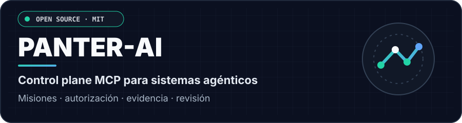</a>

**[Panter-ai](https://github.com/riquelmechile/Panter-ai)** · Proyecto MIT en desarrollo para coordinar misiones y trabajo de agentes desde aplicaciones anfitrionas, sin utilizar APIs propias de inferencia. Separa autorización, tareas, evidencia y revisión. Las integraciones reales se consideran demostradas solo cuando están verificadas en su host.

### MCP Doctor Chile · Investigación y colaboración

  <a href="https://github.com/riquelmechile/riquelmechile/blob/main/RESEARCH_COLLABORATION.md">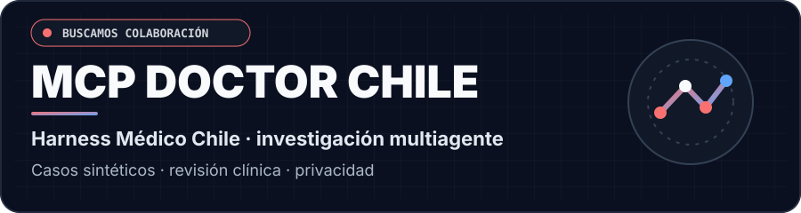</a>

**MCP Doctor Chile** es el nombre de presentación de **Harness Médico Chile**, una investigación privada y experimental sobre evaluación de razonamiento clínico entre modelos de IA, evidencia y contexto sanitario chileno. Hoy es **solo investigación con casos sintéticos**, no un producto clínico, servicio diagnóstico ni sistema validado para pacientes.

**Buscamos colaboración:** médicos, investigadores clínicos, interoperabilidad FHIR/HL7, evaluación de IA, seguridad y privacidad. La hipótesis por estudiar es si la comparación independiente y la crítica cruzada entre modelos aportan valor frente a un modelo individual; **no se afirma una mejora médica demostrada**.

**[Cómo colaborar, límites de seguridad y contacto →](https://github.com/riquelmechile/riquelmechile/blob/main/RESEARCH_COLLABORATION.md)**

### Otros sistemas públicos

  <a href="https://github.com/riquelmechile/Skills-Chile">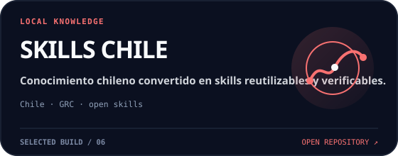</a>
  <a href="https://github.com/riquelmechile/io">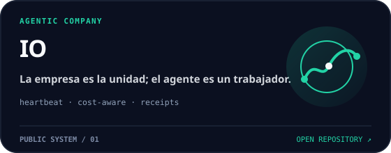</a>

  <a href="https://github.com/riquelmechile/EAUTO-AI">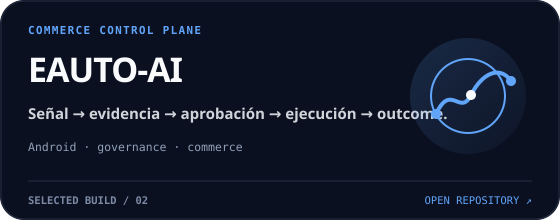</a>
  <a href="https://github.com/riquelmechile/zanaX">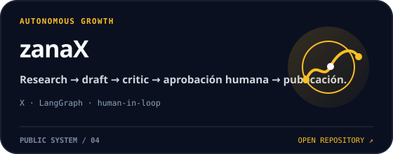</a>

**[Skills Chile](https://github.com/riquelmechile/Skills-Chile)** convierte procesos y conocimiento contextual en skills con referencias. **[IO](https://github.com/riquelmechile/io)** explora operación agéntica con costo controlado. **[EAUTO-AI](https://github.com/riquelmechile/EAUTO-AI)** aplica límites de autoridad al comercio. **[zanaX](https://github.com/riquelmechile/zanaX)** estudia automatización de investigación y publicación.

### Sistemas privados seleccionados · Casos de diseño

Los describo por el problema que resuelven, **sin enlazar a repositorios inaccesibles ni publicar su implementación interna**. Una tarjeta no equivale a una demostración pública ni a una declaración de producción.

  <a href="https://github.com/riquelmechile/riquelmechile/blob/main/PROJECTS.md#intelagent">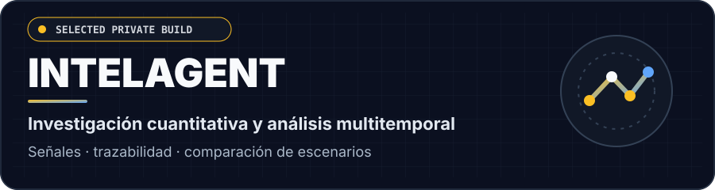</a>

  <a href="https://github.com/riquelmechile/riquelmechile/blob/main/PROJECTS.md#xanxittoo">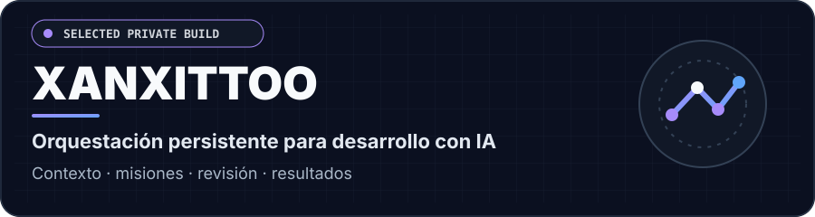</a>

  <a href="https://github.com/riquelmechile/riquelmechile/blob/main/PROJECTS.md#elcontador">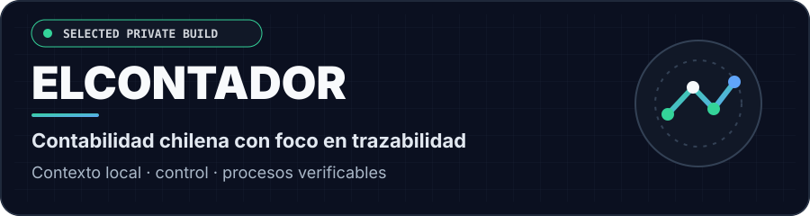</a>

**[Leer qué hacen y qué límites tienen estos sistemas →](https://github.com/riquelmechile/riquelmechile/blob/main/PROJECTS.md)**

---

## La variedad no es dispersión. Es búsqueda de estructura.

Soy **neurodivergente**. Mi manera de trabajar conecta problemas de comercio, finanzas, infraestructura, regulación, contenido e investigación. El interés común es cómo hacer que una decisión sea **autorizada, trazable, verificable y económicamente razonable**.

  <picture>
    <source media="(prefers-color-scheme: dark)" srcset="https://raw.githubusercontent.com/riquelmechile/riquelmechile/main/assets/profile/pattern-lattice-dark.svg">
    <source media="(prefers-color-scheme: light)" srcset="https://raw.githubusercontent.com/riquelmechile/riquelmechile/main/assets/profile/pattern-lattice-light.svg">
    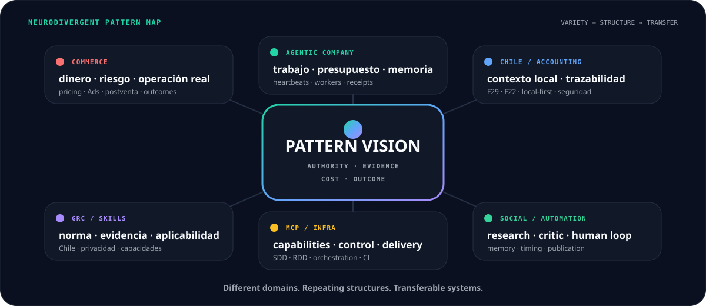
  </picture>

| Patrón que se repite | Aplicación |
| --- | --- |
| **Autoridad antes de actuar** | Operaciones económicas, herramientas MCP y permisos de agentes |
| **Evidencia antes de confianza** | Control de resultados, revisión de código e investigación |
| **Costo como parte de arquitectura** | Automatizaciones que no necesitan llamar al modelo sin una señal relevante |
| **Contexto local real** | Tributación, salud, comercio y regulaciones chilenas |
| **Aprender del desacuerdo** | Evaluación multiagente y revisión independiente, sin asumir que consenso equivale a verdad |

<strong>Cómo construyo · Especificar, probar y revisar</strong>

Para cambios técnicos trabajo con especificaciones, pruebas, revisión y resultados vinculados al candidato exacto. No confundo un test exitoso con validación de seguridad externa ni una simulación con una integración real.

**SDD → TDD → revisión independiente → evidencia de resultado.**

<strong>Pulso de contribuciones · Archivo histórico verificado</strong>

  <picture>
    <source media="(prefers-color-scheme: dark)" srcset="https://raw.githubusercontent.com/riquelmechile/riquelmechile/main/assets/profile/execution-pulse-dark.svg">
    <source media="(prefers-color-scheme: light)" srcset="https://raw.githubusercontent.com/riquelmechile/riquelmechile/main/assets/profile/execution-pulse-light.svg">
    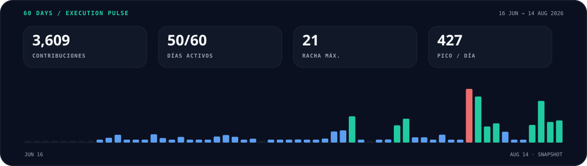
  </picture>

**Archivo histórico, no contador actual:** corte del 17-AGO-2026 (19-JUN a 17-AGO, 60 días). GitHub registró entonces 3.935 contribuciones, 3.115 commits y 52 días activos. Se conserva por trazabilidad; requiere una nueva consulta verificable para actualizarlo.

---

  <strong>Build verifiable systems. Connect patterns. Measure outcomes.</strong> 
  Desde Chile · Operar primero · Automatizar con límites · Verificar siempre

  <a href="https://github.com/riquelmechile/riquelmechile/blob/main/RESEARCH_COLLABORATION.md">Colaboración médica</a> ·
  <a href="https://github.com/riquelmechile/riquelmechile/blob/main/PROJECTS.md">Sistemas privados seleccionados</a> ·
  <a href="https://github.com/riquelmechile?tab=repositories">Repositorios</a> ·
  <a href="https://www.linkedin.com/in/sebastian-riquelme-vera-482778198">LinkedIn</a>

